# Vanks OS

Дистрибутив на базе **Arch Linux**: live-флешка загружается целиком в оперативную
память, показывает собственный рабочий стол **Delta** и сразу предлагает
установщик, в котором можно выбрать рабочий стол — **Delta** (по умолчанию) или
**GNOME**. Если видеокарта не тянет Hyprland, есть безопасный режим: только
установщик с программной отрисовкой.

[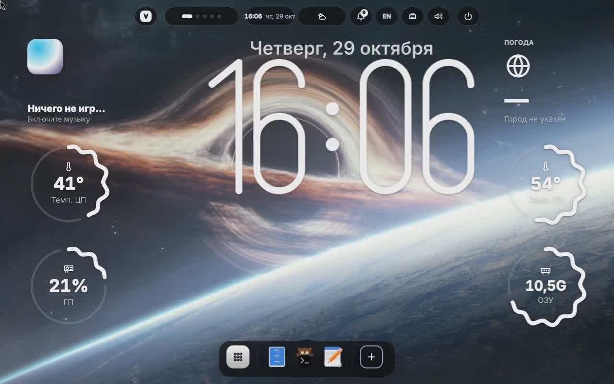](docs/media/delta-demo.mp4)

*Нажмите на картинку — видео 2 мин, 1080p60: первая настройка, музыка на острове, окно приложений, живые обои, темы (и светлая), «джинн», рабочие столы, редактор виджетов, уведомления, «Настройки» на английском, запуск .exe, экран блокировки. Полное качество — в [релизе](https://github.com/ArtyomVank/Vanks0s/releases/latest).*

| | |
|---|---|
| 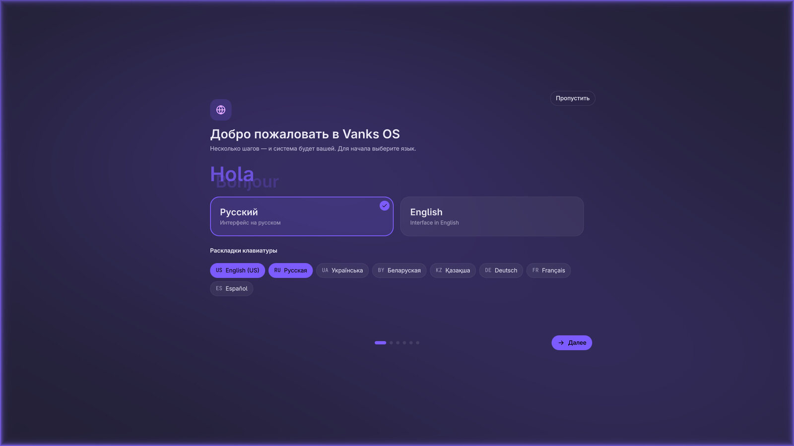 | 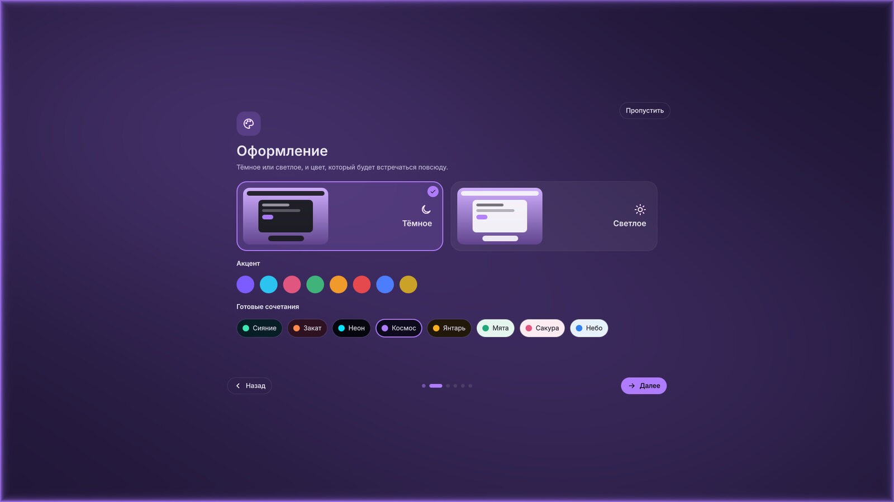 |
| *Первая настройка на весь экран* | *Тема и акцентный цвет* |
| 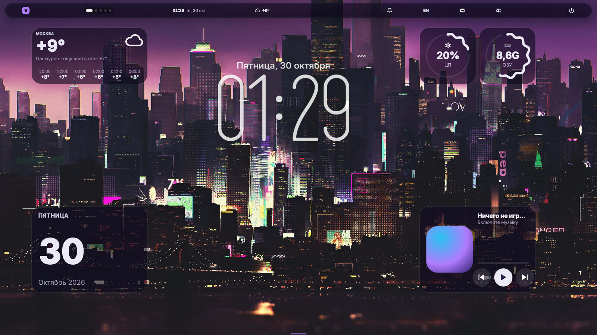 | 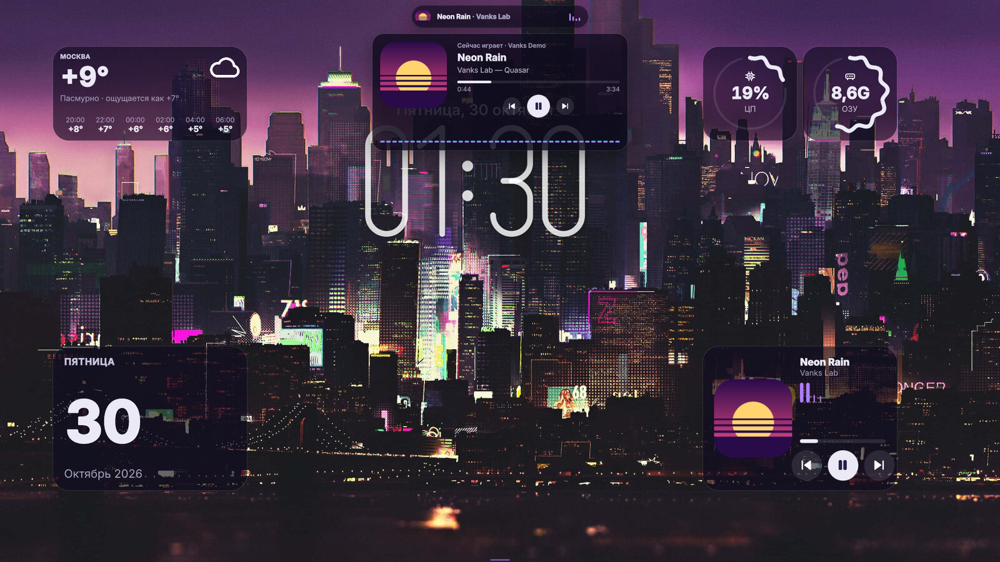 |
| *Рабочий стол с виджетами* | *Музыка: остров и меню с обложкой* |
| 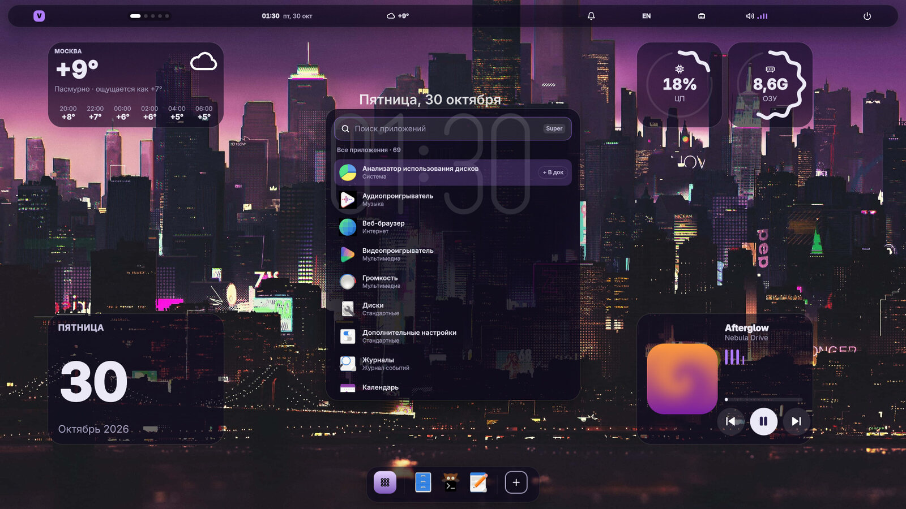 | 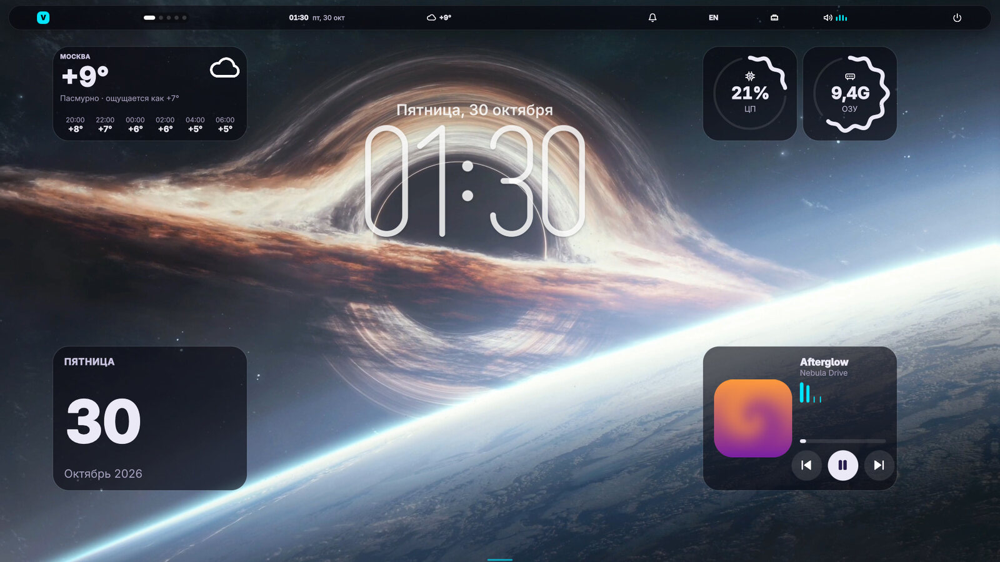 |
| *Окно приложений с поиском* | *Живые обои и тема «Неон»* |
| 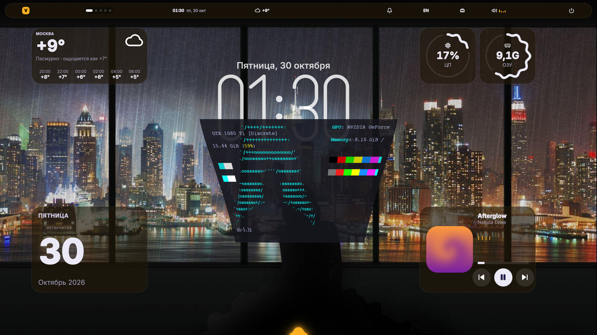 | 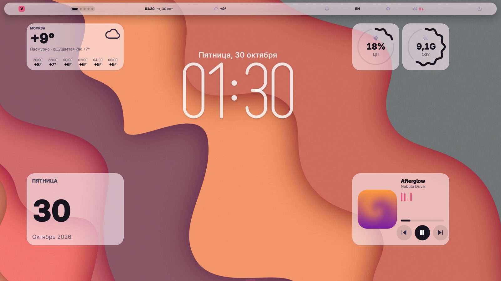 |
| *Окно сворачивается в док «джинном»* | *Светлая тема «Сакура»* |
| 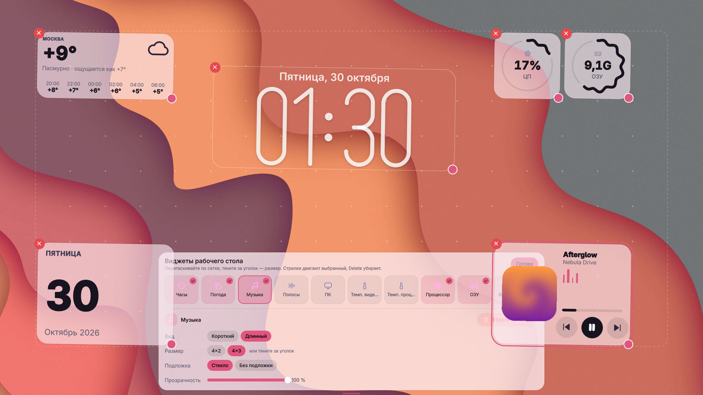 | 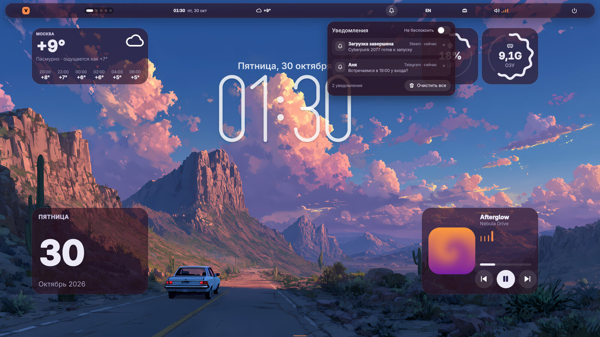 |
| *Редактор виджетов* | *Центр уведомлений* |
| 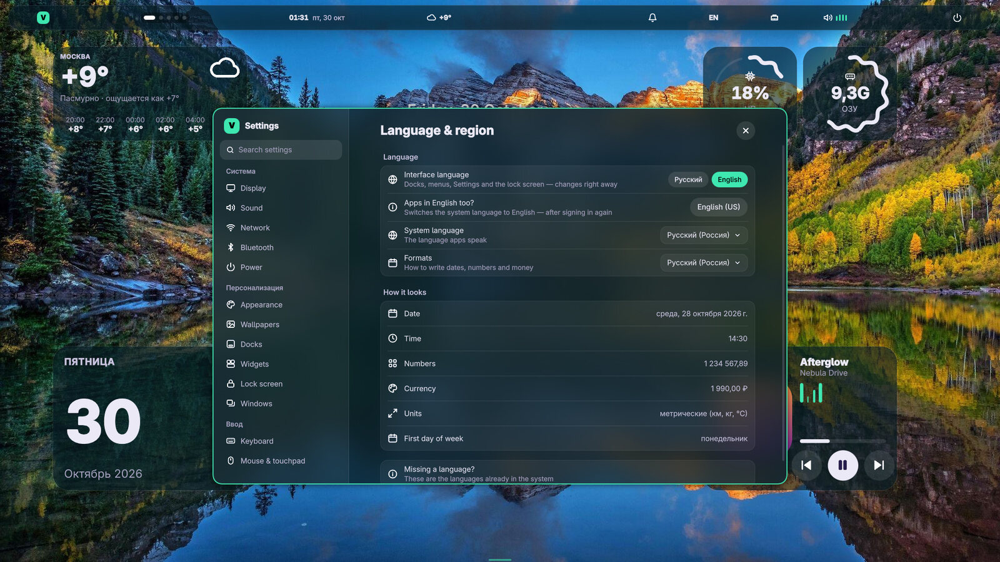 | 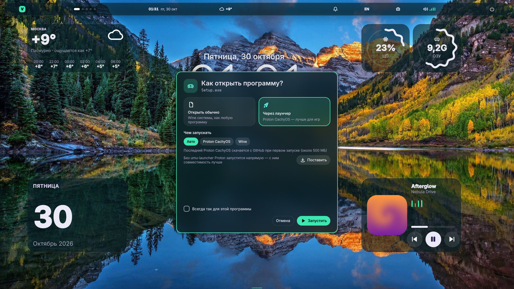 |
| *«Настройки» — язык меняется на лету* | *Программа Windows: обычно или через Proton CachyOS* |
| 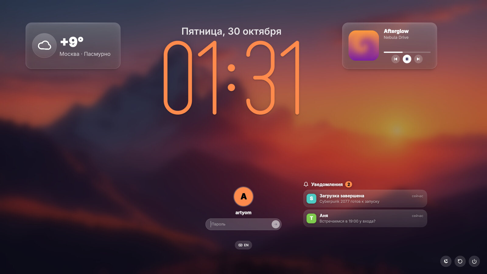 | 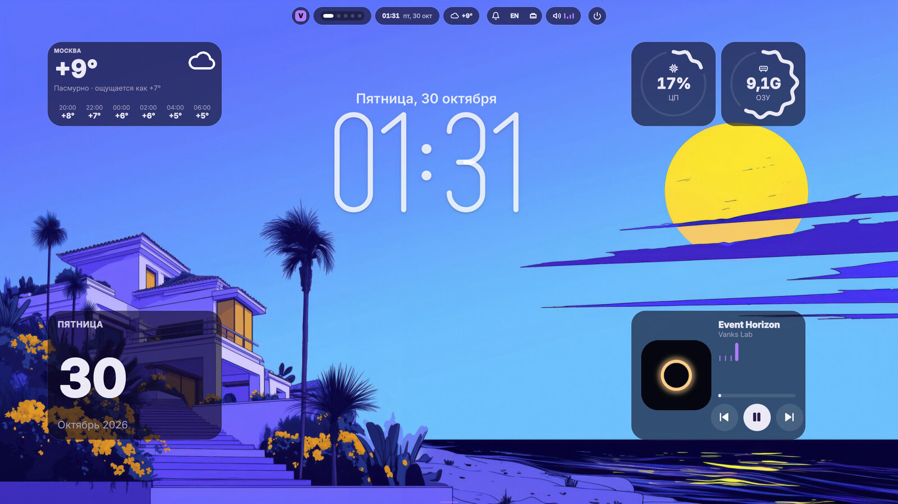 |
| *Экран блокировки: погода, музыка, уведомления* | *Верхний док «плитками»* |

Видео и снимки пишет `tools/delta-demo.sh` — чистая вложенная сессия, всё через IPC; музыка — `tools/demo-player.py` (MPRIS без звука).

```
Флешка → syslinux/systemd-boot → squashfs копируется в RAM → greetd → автовход vanks в Delta
       → установщик Calamares → выбор стола → pacstrap → готовый Arch
```

Версия **0.5 «Magnetar»**: «желе» при перетаскивании окна, прилипание к краям экрана с подсветкой, новые виджеты (часы со стрелками, сеть, таймер, солнце), звуки и искры в лаунчере и первой настройке; с 0.4 — первая настройка, английский язык, запуск .exe через Proton CachyOS
(библиотеки для игр, драйвер под вашу видеокарту, Steam и магазин приложений). Готовый ISO — в [релизах](https://github.com/ArtyomVank/Vanks0s/releases/latest)
(образ разделён на две части, как склеить — в описании релиза). Собрать ISO
самому можно на Arch-машине (см. [docs/BUILD.md](docs/BUILD.md)).

---

## Что уже есть

| Часть | Где | Состояние |
|---|---|---|
| archiso-профиль, BIOS + UEFI, `copytoram=y` | `iso/` | готово |
| Live-сессия: greetd, автовход в Delta, безопасный режим (cage), автозапуск установщика | `iso/airootfs/` | готово, не проверено на железе |
| Брендинг (логотип, обои, карточки столов, QSS, QML-заставка) | `calamares/branding/vankos/`, `tools/gen_branding.py` | готово, картинки сгенерированы |
| Экран выбора оболочки | `calamares/modules/shellchooser.conf` | готово |
| Установка: `pacstrap` → базовые пакеты → выбранный стол → GRUB | `iso/airootfs/usr/local/lib/vankos/` | готово, не проверено на железе |
| Окружение Delta (пакет собирается при сборке ISO) | `delta/`, `packaging/delta/PKGBUILD`, `tools/build-delta.sh` | см. [docs/DELTA.md](docs/DELTA.md) |
| Офлайн-репозиторий на ISO | `build.sh` | готово, не проверено |
| Сборка Calamares (нет в репозиториях Arch) | `packaging/calamares/PKGBUILD`, `tools/build-calamares.sh` | автоматически при сборке ISO |
| Статические проверки проекта | `tools/validate.sh` | работает, 0 ошибок |

## Структура

```
vankos/
├── build.sh                     # сборка ISO (Arch, root)
├── iso/                         # archiso-профиль
│   ├── profiledef.sh            # имя, метка, режимы загрузки
│   ├── packages.x86_64          # пакеты live-системы (Delta)
│   ├── pacman.conf              # репозитории сборки (+ CacheDir)
│   ├── syslinux/                # BIOS-загрузка
│   ├── efiboot/                 # UEFI (systemd-boot)
│   ├── lists/                   # target-base / delta / gnome
│   └── airootfs/                # оверлей live-системы
│       ├── etc/                 # gdm, polkit, dconf, sudoers, os-release
│       ├── usr/local/bin/       # запуск установщика, подготовка сессии
│       ├── usr/local/lib/vankos # bootstrap / desktop / cleanup
│       └── usr/share/vankos/    # списки пакетов, конфиг greetd для live
├── calamares/                   # установщик
│   ├── settings.conf            # последовательность экранов и шагов
│   ├── modules/                 # shellchooser, users, partition, bootloader...
│   └── branding/vankos/         # branding.desc, QSS, slideshow, картинки
├── tools/
│   ├── gen_branding.py          # генерация PNG (Pillow)
│   ├── validate.py              # статические проверки
│   └── run-qemu.sh              # тест ISO в виртуалке
└── docs/                        # сборка, архитектура, тестирование, планы
```

## Быстрый старт (на Arch)

```bash
sudo pacman -S --needed archiso arch-install-scripts squashfs-tools libisoburn \
    mtools dosfstools e2fsprogs erofs-utils grub syslinux edk2-shell python-pillow

cd vankos
chmod +x build.sh tools/*.sh
./tools/validate.sh          # быстрые проверки конфигов
sudo ./build.sh              # 20-60 минут, ISO в build/out/
./tools/run-qemu.sh          # проверить в виртуалке (нужно >= 8 ГБ RAM)
```

Запись на флешку:

```bash
sudo dd if=build/out/vankos-*.iso of=/dev/sdX bs=4M status=progress oflag=sync
```

Две сборки:

* `sudo ./build.sh` — **полная**: в ISO кладётся локальный репозиторий, установка
  идёт без интернета (ISO ≈ 3.5–4.5 ГБ).
* `sudo VANKOS_OFFLINE=0 ./build.sh` — **slim**: репозитория нет, установщик
  тянет пакеты с зеркал Arch (ISO ≈ 1.5–2 ГБ).

При первой сборке `build.sh` сам собирает **Calamares**: пакета нет в
репозиториях Arch, поэтому он компилируется из `packaging/calamares/PKGBUILD`
(5–15 минут, пакет кэшируется в `build/pkgs`). Отдельно:

```bash
sudo ./tools/build-calamares.sh    # только установщик
```

## Как устроена установка

1. **Экран «Рабочий стол»** (`packagechooser`) пишет выбор в GlobalStorage
   как `packagechooser_shell`.
2. **`bootstrap.sh`** (шаг `shellprocess@bootstrap`) запускает `pacstrap`:
   базовая система из локального репозитория на ISO (или из сети), ключи pacman,
   `/etc/pacman.conf`, `os-release`.
3. **`desktop.sh`** (шаг `shellprocess@desktop`) читает выбор через
   `${gs[packagechooser_shell]}` и ставит соответствующий набор пакетов:
   * `gnome` → `gnome`, `gdm`, порталы, `gvfs`; включается `gdm.service`;
   * `delta` (по умолчанию) → `delta`, `greetd`, `kitty`, Nautilus, Firefox…;
     ставятся конфиг и PAM greetd из пакета delta, включается `greetd.service`.
4. Дальше стандартные модули Calamares: `machineid`, `fstab`, `locale`,
   `keyboard`, `localecfg`, `users`, `networkcfg`, `hwclock`, `initcpiocfg`,
   `initcpio`, `bootloader` (GRUB), и `cleanup.sh` перед `umount`.

Подробности — в [docs/ARCHITECTURE.md](docs/ARCHITECTURE.md).

## Ограничения версии 0.3

* ISO ни разу не собирался на этой машине: здесь нет Linux/Arch. Все конфиги
  сверены с upstream, но первый прогон `build.sh` — за вами.
* Экран выбора стола — это `packagechooser` с брендингом Vanks OS, а не
  собственный C++/QML-модуль. Полностью свой экран требует сборки плагина
  Calamares и записан в [docs/ROADMAP.md](docs/ROADMAP.md).
* Шифрование LUKS, btrfs-снапшоты, Secure Boot и подпись ISO не настроены.
* Нет собственных репозиториев пакетов: используются `core`/`extra` Arch.

## Дальше

`docs/ROADMAP.md` — этапы 0.2 (первая успешная сборка и тесты), 0.3 (свой
QML-экран выбора стола), 0.4 (LUKS, btrfs, Secure Boot).
